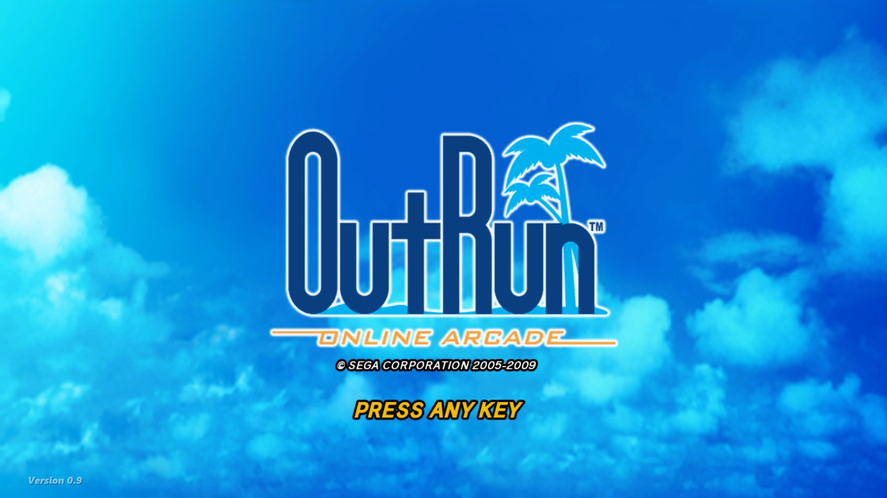
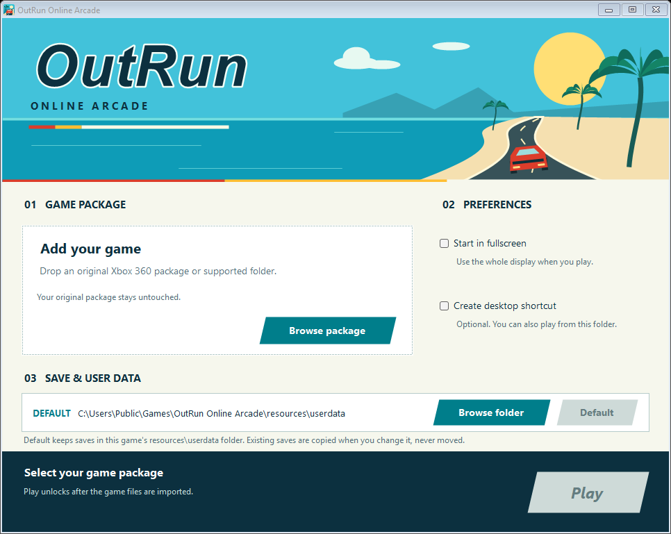
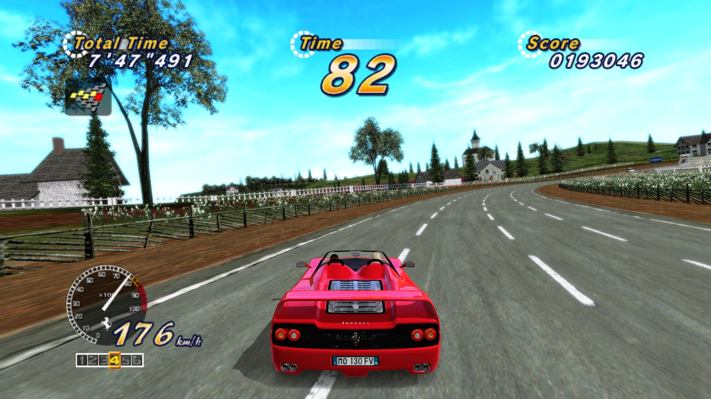
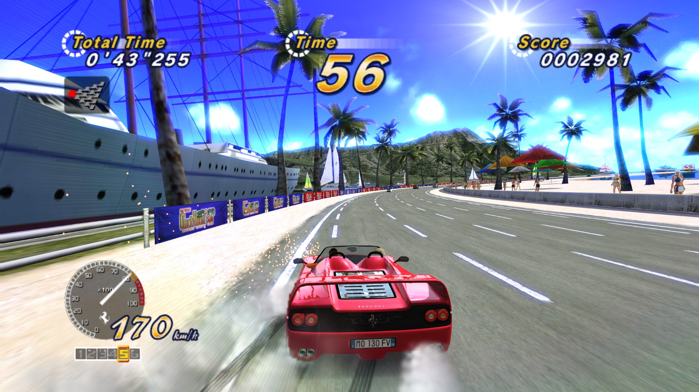
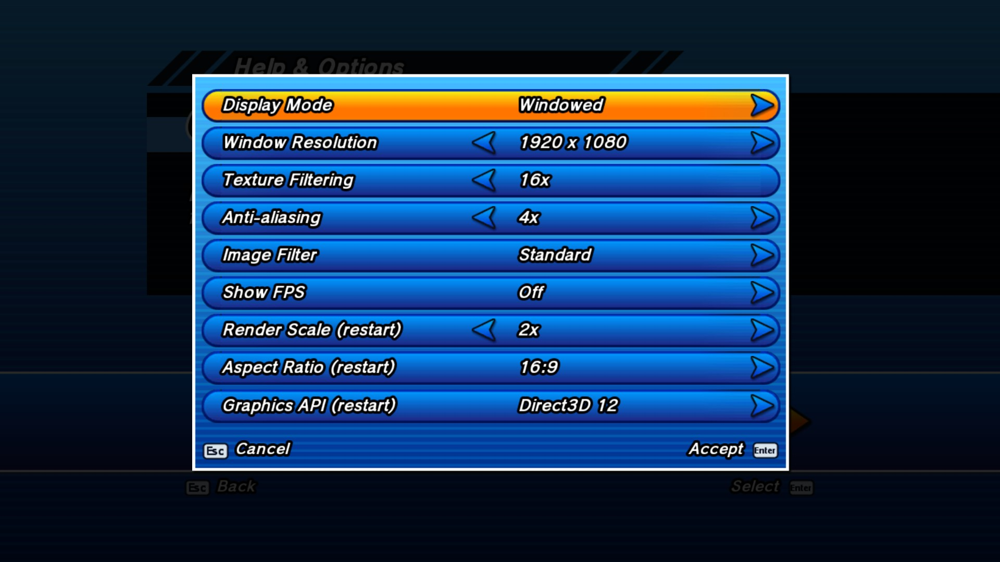
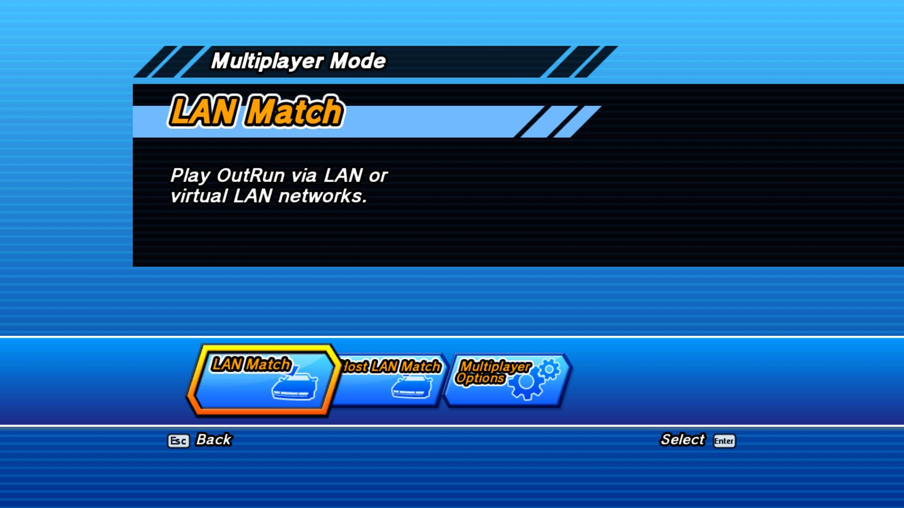
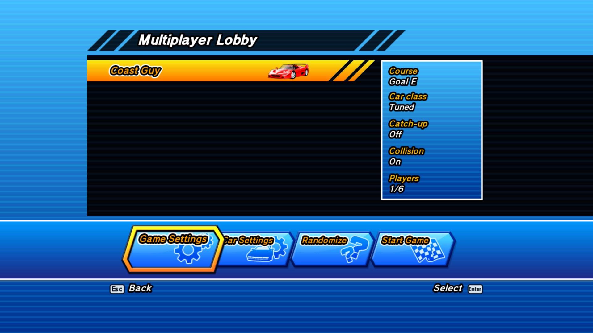

# OutRun Online Arcade XBLA PC Recomp

A native Windows PC port of **OutRun Online Arcade**, SEGA's 2009 Xbox 360 / XBLA racer, built using [ReXGlue](https://github.com/rexglue/rexglue-sdk) static recompilation.

Race through all 15 stages and 5 goals at **up to 4K and 60 FPS**, with a native Direct3D 12 / Vulkan renderer, an optional HD HUD, keyboard, mouse and controller support, and LAN / Virtual LAN multiplayer. No emulator required.

**Free and open-source.** If you enjoy it, you can [support me on Ko-fi](https://ko-fi.com/caiuscodes).

> **You must provide your own copy of OutRun Online Arcade (XBLA).** No original game files or assets are distributed with this project. The launcher imports the required files from your Xbox 360 game package during first-time setup.

## Download & Installation

**[Download the latest release](https://github.com/CaiusCodes/Outrun-Arcade-Online-XBLA-PC-Recomp/releases)**

1. Download the latest ZIP and extract the **OutRun Online Arcade** folder.
2. Run `OutRun Online Arcade.exe`.
3. Select your OutRun Online Arcade XBLA package using **Browse package**, or drop it onto the window.
4. Choose your options: start in fullscreen, create a desktop shortcut, and optionally a folder of your own for saves and user data.
5. Click **Play**.

After setup, simply run `OutRun Online Arcade.exe` to play. Your original game package is no longer needed and is never changed.

**To reopen setup:** select **Help & Options → Setup** in the game, or hold **Shift** while launching.

The installation is portable: imported game files, saves and settings are stored inside the game folder (`resources\`). Saves and user data can be kept in another folder instead (another drive or a synced folder) from the setup window.

### System Requirements

- Windows 10 or 11 (64-bit)
- DirectX 12 or Vulkan-compatible graphics card
- Your own OutRun Online Arcade XBLA package (Title ID `58410968`, revision `0.0.1.5`)

## Features

### Graphics & Performance

- **Native PC rendering** (Plume) on **Direct3D 12** or **Vulkan**, with the original Xenos renderer kept as a fallback
- **Up to 4K** window resolution, fullscreen and windowed modes
- **60 FPS** with V-Sync and an optional FPS counter
- **Render Scale** 1x, 2x or 3x
- **Anti-aliasing** up to 8x MSAA (4x by default) and **Texture Filtering** up to 16x
- **AMD FSR** and sharpening image filters
- **16:9** and **4:3** aspect ratios
- **HUD:** Original, Sharp, **HD** (redrawn at high resolution) or Off
- Vivid Colors, Contrast and Black Level picture settings
- Shaders are translated once on your PC and cached; the menus, title and first stages are prepared ahead so races start smoothly

### Controls & Quality of Life

- **Xbox controller** and **keyboard** support; on-screen button prompts show keyboard keys when no controller is connected
- **Mouse** support in every menu: hover, click, right click to go back, wheel to scroll, clickable footer prompts
- Native PC settings in **Help & Options** (Settings, Graphics, Audio Options, Controls), with a restart prompt for settings that need one
- Local high-score initials entered directly in the game's ranking table, with pad or keyboard
- **Exit Game** from the main menu; Xbox LIVE-only menus, achievements and "Connecting" panels removed
- Built-in **update checker** (Help & Options → Check for Updates)
- Portable installation with local saves and settings

### Multiplayer

- **LAN multiplayer** and online play through Virtual LAN services
- Compatible with Radmin VPN, ZeroTier, Tailscale and Hamachi
- Automatic lobby discovery, with a manual host address as a fallback
- Online name and ping display in **Multiplayer → Multiplayer Options**

No Xbox Live connection is required.

## Keyboard Controls

| Key | Action |
|---|---|
| W | Accelerate |
| S | Brake |
| A, D | Steer |
| Space | A / Select |
| Backspace | B / Back |
| Enter | Start / Select |
| Esc | Pause (in a race) / Back (in menus) |
| Q, E | X, Y |
| Z, C | LB, RB |
| Mouse | Menus: hover, click, right click = back, wheel = scroll |

An Xbox controller is recommended and uses the original console controls.

## Improvements & Fixes

- A native renderer that matches the original look across all 15 stages and the endings, on Direct3D 12 and Vulkan.
- Removed Xbox LIVE functionality that cannot work on PC (Friends filters, Gamer Card, achievements menu, "Connecting" panels, Return to Game Library).
- LAN and virtual-LAN play in place of Xbox LIVE matchmaking.
- Audio fixes for clicks, loops and start volume.
- Keyboard and mouse navigation throughout the front end.

For detailed changes, see the [GitHub Releases](https://github.com/CaiusCodes/Outrun-Arcade-Online-XBLA-PC-Recomp/releases).

## Updates

Check for new versions through **Help & Options → Check for Updates**.

Updates are downloaded and installed without affecting your imported game files, saves or settings.

Alternatively, download the latest release ZIP and extract it over your existing installation.

## Known Limitations

- Windows only.
- Only the supported OutRun Online Arcade XBLA build (Title ID `58410968`, revision `0.0.1.5`) is accepted; DLC is not imported.
- Mostly tested on NVIDIA graphics; AMD and Intel GPUs have had less testing.
- LAN play between different PCs has had limited testing.
- Some issues inherited from the original game or the recompilation may remain (for example a faint pop on some sound effects).
- Windows SmartScreen may warn about the unsigned executable.
- Windows Firewall may request permission for multiplayer connections.

**Renderer compatibility:** if you experience issues with the native renderer, the original renderer can be enabled by setting `gpu_native = false` in `resources\outrun.toml`.

## Reporting Issues

Found a bug? [Open a GitHub Issue](https://github.com/CaiusCodes/Outrun-Arcade-Online-XBLA-PC-Recomp/issues).

1. Close the game.
2. Attach the latest log from `resources\logs\` (the newest `outrun_NNN.log`) to your report.
3. Describe what happened, roughly when (the time of day or how long into the session) and where (stage, menu).

The log lists your Windows version, graphics card, driver, settings and the stages you played, so there is no need to type them out.

## Building from Source

The port is built from your own `default.xex`, which the ReXGlue code generator translates into C++ (never committed). You need Visual Studio 2022 or later with the C++ tools, LLVM/Clang, CMake 3.25+, Ninja and Python 3.

1. `Import Game.bat`: imports your package into `private\assets` (ignored by git).
2. `tools\Setup-Sdk.ps1`: fetches ReXGlue at the pinned commit, applies `patches\`, builds and installs it to `out\sdk-install`.
3. `tools\Get-NativeRendererDeps.ps1`: fetches Plume and XenosRecomp with their patches.
4. `Build PC Port.bat`: generates the code and builds `outrun.exe`.
5. `Make Release.bat`: builds the release ZIP (`tools\Make-Release.ps1`).

## Development & Credits

This project builds upon the work of:

- [ReXGlue](https://github.com/rexglue/rexglue-sdk) by Tom Clay and contributors – Static recompilation framework (with Xenia-derived code).
- [Plume](https://github.com/zolaware/plume) and [XenosRecomp](https://github.com/hedge-dev/XenosRecomp) – Native rendering and shader translation.
- [SDL3](https://www.libsdl.org/), [libmspack](https://github.com/kyz/libmspack), [Tracy](https://github.com/wolfpld/tracy), AMD FidelityFX FSR/CAS and Microsoft's DirectX Shader Compiler.
- Extract-STFS / Velocity – Xbox 360 package (STFS) layout used by the importer.

The project's own game-port code is released under [The Unlicense](LICENSE). Third-party components retain their respective licences; see [packaging/licenses](packaging/licenses).

## Support Development

If you enjoy the project and would like to support future PC recompilation projects, you can [support me on Ko-fi](https://ko-fi.com/caiuscodes).

---

*OutRun and SEGA are trademarks or registered trademarks of SEGA Corporation. Xbox and Xbox 360 are trademarks of Microsoft. This is an independent fan project and is not affiliated with or endorsed by the rights holders.*
